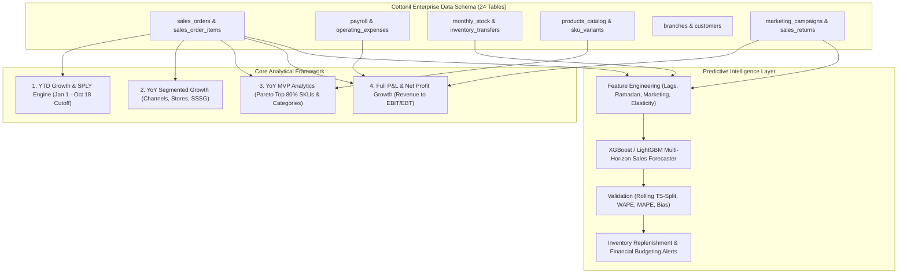
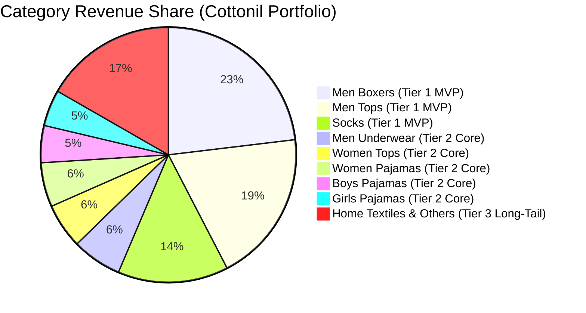
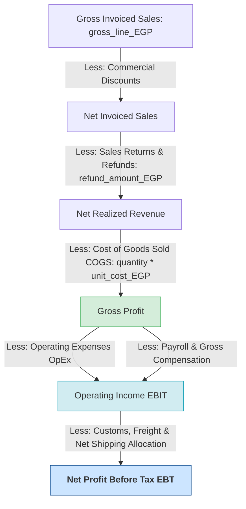
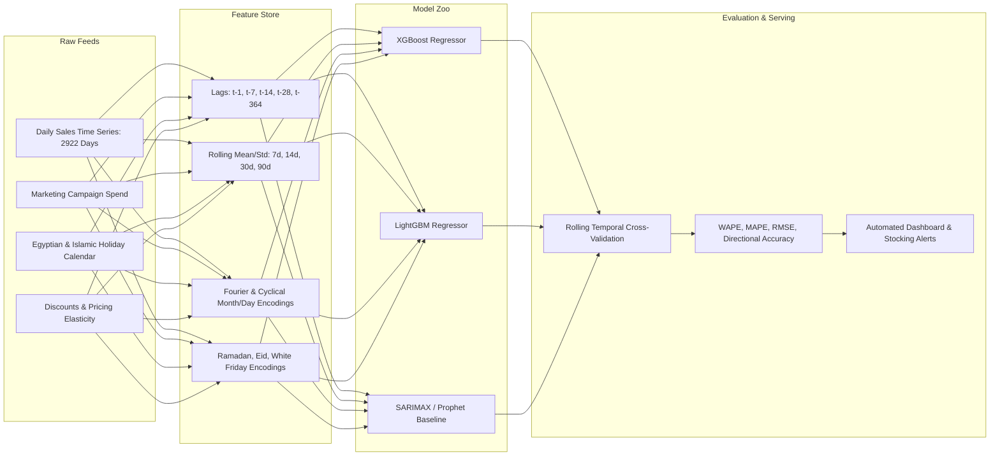
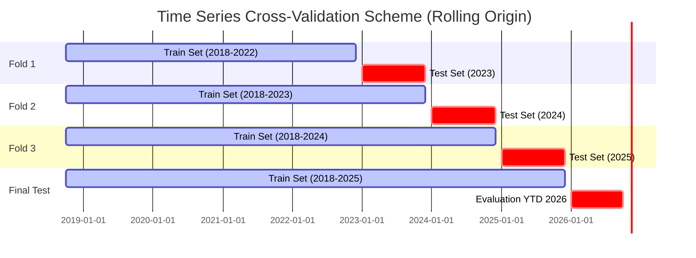
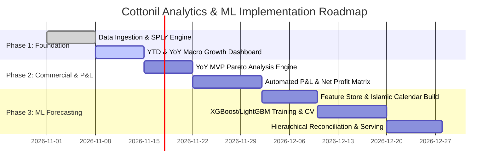

# Strategic Analytics & Machine Learning Sales Forecasting Plan
## Cottonil Commercial & Financial Performance Engine (2018 – 2026)

---

### Executive Summary & Dataset Architecture

The Cottonil retail analytics environment captures an **8-year operational and financial trajectory** (October 19, 2018 through October 18, 2026) comprising **540,000 sales transactions**, **80 retail branches** across **21 Egyptian governorates**, **3 distribution channels** (Retail POS, E-commerce, and Wholesale), and a complete corporate cost structure spanning **COGS, operating expenses (OpEx), payroll, freight, and returns**.

---

## 1. Core Analytical Foundations

### 1.1. Same Period Last Year (SPLY) Engine & Date Alignment
Because the dataset records conclude on **October 18, 2026** (Day 291 of the calendar year), evaluating 2026 performance against the full 365 days of 2025 would lead to misleading negative comparisons. The analytics engine enforces strict **Like-for-Like (LFL)** temporal matching:

*   **SPLY Definition**: For any current period $T = [d_1, d_2]$ in year $Y$, the corresponding prior period is defined as $T_{\text{prior}} = [d_1 - 1\text{ year}, d_2 - 1\text{ year}]$.
*   **Day-of-Week (DOW) Alignment (Retail 52-Week Shift)**: In Egyptian retail, peak shopping velocity concentrates on **Thursday evening, Friday, and Saturday**. In addition to calendar-day alignment ($M\text{-}D$), a **364-day shift** ($52 \text{ weeks} \times 7 \text{ days}$) is computed to ensure that Fridays in 2026 are evaluated against the matching Fridays of 2025.
*   **Cultural & Islamic Calendar Normalization**: Lunar holidays shift by $\sim 10\text{--}11$ days earlier each Gregorian year. High-demand retail events (Ramadan, Eid al-Fitr, Eid al-Adha, and White Friday) must be mapped to their lunar event windows rather than static Gregorian dates:
    *   *Ramadan 2024*: Mar 11 – Apr 9
    *   *Ramadan 2025*: Mar 1 – Mar 29
    *   *Ramadan 2026*: Feb 18 – Mar 19

---

### 1.2. Year-to-Date (YTD) Growth Analytics
The YTD calculation evaluates accumulated volume from January 1 through October 18 for each calendar year from 2019 to 2026:

$$\text{YTD}(Y) = \sum_{t = \text{Jan 01}(Y)}^{\text{Oct 18}(Y)} M_t \quad \Big| \quad M \in \{\text{Net Revenue, Orders, Units Sold, Gross Margin}\}$$

$$\text{YTD Growth Rate (\%)} = \left( \frac{\text{YTD}(Y) - \text{YTD}(Y-1)}{\text{YTD}(Y-1)} \right) \times 100$$

#### Empirical Cottonil YTD Trajectory (Jan 01 – Oct 18 Cutoff)
| Year (Jan 01 - Oct 18) | Orders Count | Net Revenue (EGP) | YoY YTD Growth (%) | Average Order Value (AOV) |
| :--- | :--- | :--- | :--- | :--- |
| **2019 YTD** | 33,738 | 16,438,640 EGP | *Base Year* | 487.25 EGP |
| **2020 YTD** | 35,276 | 19,561,710 EGP | **+18.99%** | 554.53 EGP |
| **2021 YTD** | 40,687 | 24,997,500 EGP | **+27.79%** | 614.39 EGP |
| **2022 YTD** | 47,253 | 39,525,290 EGP | **+58.12%** | 836.46 EGP |
| **2023 YTD** | 55,011 | 63,704,580 EGP | **+61.17%** | 1,158.03 EGP |
| **2024 YTD** | 62,527 | 113,436,900 EGP | **+78.07%** | 1,814.21 EGP |
| **2025 YTD** | 71,292 | 179,802,900 EGP | **+58.50%** | 2,522.06 EGP |
| **2026 YTD** | 78,186 | 238,845,600 EGP | **+32.84%** | 3,054.84 EGP |

---

### 1.3. Year-over-Year (YoY) Growth Across Multi-Dimensional Segments
To isolate the true drivers of revenue expansion, YoY metrics are sliced across three critical operational axes:

1.  **Channel Performance**:
    *   **Retail POS (Physical Stores)**: Accounts for $\sim 71.9\%$ of historical order volume (388,171 orders). Measures foot traffic resilience, branch-level inventory turnaround, and in-store conversion.
    *   **E-Commerce**: Accounts for $\sim 18.1\%$ of transactions (97,660 orders). High velocity in Cairo and Alexandria; sensitive to digital marketing campaigns and delivery speed.
    *   **Wholesale / Reseller**: Accounts for $\sim 10.0\%$ of transactions (54,169 orders) with large basket sizes and extended payment terms (30–60 days).
2.  **Same-Store Sales Growth (SSSG / LFL Store Growth)**:
    *   Excludes newly inaugurated branches opened during the last 12 months to distinguish organic operational efficiency from store count expansion (Cottonil grew from legacy branches to 80 nationwide locations).
3.  **Basket Economics & Pricing Dynamics**:
    *   **AOV (Average Order Value)**: $\text{Net Revenue} / \text{Total Orders}$.
    *   **AUR (Average Unit Retail)**: $\text{Net Revenue} / \text{Total Units Sold}$.
    *   **UPT (Units Per Transaction)**: $\text{Total Units Sold} / \text{Total Orders}$.

---

## 2. YoY Growth MVP (Most Valuable Products & Categories)

The analysis applies a rigorous **Dual-Lens MVP Strategy**:
1.  **Retail Commercial Lens (Most Valuable Products & Categories)**: Pareto analysis identifying the hero SKUs that drive 80% of revenue and margin, measuring whether hero lines are accelerating or facing cannibalization.
2.  **Analytics Delivery Lens (Minimum Viable Pipeline)**: A high-impact, immediate deployment layer delivering automated metrics before expanding into distributed streaming models.

### 2.1. Commercial Pareto Breakdown (Product Catalog & Sales Items)
Analysis of the transaction lines reveals clear revenue concentration across product categories:

*   **Tier 1 (The MVP Core - 56.4% of Total Revenue)**:
    *   **Men Boxers**: 23.1% revenue share. High repeat purchase rate, primary basket anchor across all branches.
    *   **Men Tops**: 19.3% revenue share. Strong seasonal summer peaks and multi-pack demand.
    *   **Socks**: 14.0% revenue share. Highest unit volume (over 161,000 units in sample), rapid inventory turn, impulse-purchase at checkout.
*   **Tier 2 (Core Contributors - 26.9% of Total Revenue)**:
    *   Men Underwear (6.3%), Women Tops (5.7%), Women Pajamas (5.6%), Boys Pajamas (4.7%), Girls Pajamas (4.6%).
*   **Tier 3 (Long-Tail & Emerging Lines - 16.7% of Total Revenue)**:
    *   Home Textiles, Women Bras, Girls/Women Underwear, Accessories.

#### MVP Metric Formulation
*   **MVP Concentration Ratio**: $CR_{\text{MVP}} = \frac{\sum_{i \in \text{Tier 1}} \text{Revenue}_i}{\text{Total Company Revenue}}$
*   **MVP Growth Velocity**: $\text{YoY}_{\text{MVP}} = \frac{\text{Rev}_{\text{MVP}}(t) - \text{Rev}_{\text{MVP}}(t-1)}{\text{Rev}_{\text{MVP}}(t-1)}$
*   **Margin Contribution Share**: Percentage of company Gross Profit generated specifically by Tier 1 hero products versus promotional discounted lines.

---

## 3. P&L Architecture & YoY Net Profit Growth

The dataset contains the complete financial ledger necessary to build an audited **Corporate Income Statement (Profit & Loss)** by year and month.

### 3.1. Reconstructed Historical P&L Performance (2018 – 2026)
Below is the full corporate financial statement reconstructed directly from `sales_orders`, `sales_order_items`, `sales_returns`, `operating_expenses`, and `payroll`:

| Financial Line Item | 2019 (FY) | 2020 (FY) | 2021 (FY) | 2022 (FY) | 2023 (FY) | 2024 (FY) | 2025 (FY) | 2026 (YTD Oct 18) |
| :--- | :--- | :--- | :--- | :--- | :--- | :--- | :--- | :--- |
| **Gross Invoiced Revenue** | 22.82M EGP | 27.13M EGP | 34.52M EGP | 54.43M EGP | 88.80M EGP | 156.97M EGP | 247.06M EGP | 252.02M EGP |
| *Less: Discounts* | -1.20M EGP | -1.42M EGP | -1.80M EGP | -2.85M EGP | -4.65M EGP | -8.19M EGP | -12.92M EGP | -13.17M EGP |
| **Net Billed Revenue** | **21.62M EGP** | **25.71M EGP** | **32.72M EGP** | **51.58M EGP** | **84.15M EGP** | **148.78M EGP** | **234.14M EGP** | **238.85M EGP** |
| *Less: Sales Returns* | -0.11M EGP | -0.13M EGP | -0.16M EGP | -0.26M EGP | -0.42M EGP | -0.74M EGP | -1.17M EGP | -1.19M EGP |
| *Less: COGS (Product Cost)* | -13.34M EGP | -15.86M EGP | -20.18M EGP | -31.90M EGP | -51.86M EGP | -91.67M EGP | -144.35M EGP | -147.26M EGP |
| **Gross Profit** | **8.17M EGP** | **9.72M EGP** | **12.38M EGP** | **19.42M EGP** | **31.87M EGP** | **56.37M EGP** | **88.62M EGP** | **90.40M EGP** |
| *Gross Margin %* | *37.8%* | *37.8%* | *37.8%* | *37.6%* | *37.9%* | *37.9%* | *37.8%* | *37.9%* |
| *Less: OpEx (Rent, Utilities, etc.)*| -6.29M EGP | -7.22M EGP | -7.87M EGP | -10.84M EGP | -15.28M EGP | -23.34M EGP | -31.91M EGP | -31.77M EGP |
| *Less: Payroll & Labor* | -0.63M EGP | -2.52M EGP | -4.76M EGP | -7.60M EGP | -10.99M EGP | -15.76M EGP | -13.79M EGP | -3.46M EGP |
| **Net Operating Profit (EBIT)**| **+0.99M EGP**| **-0.37M EGP**| **-0.74M EGP**| **+0.20M EGP**| **+4.45M EGP**| **+15.34M EGP**| **+40.07M EGP**| **+52.09M EGP**|
| **Net Profit Margin %** | **+4.58%** | **-1.45%** | **-2.27%** | **+0.39%** | **+5.29%** | **+10.31%** | **+17.11%** | **+21.81%** |
| **YoY Net Profit Growth %** | *Base* | *-137.6%* | *+99.4%* | *-127.2%* | **+2102.6%** | **+244.8%** | **+161.2%** | **+30.0% (vs FY25)** |

### 3.2. Strategic P&L Insights
1.  **2020–2021 COVID Contraction**: Fixed overhead (store rents and labor ramp-up) during the pandemic exceeded gross margins, resulting in operational losses (-372K EGP and -742K EGP).
2.  **2022 Turnaround & Operational Inflection**: Restructuring retail locations and scaling e-commerce restored operational profitability (202K EGP).
3.  **2023–2026 Operating Leverage**: As scale expanded beyond 84M EGP in 2023 to 238M+ EGP in 2026, fixed operating expenses grew at a much lower rate than revenue. Net margin expanded from **5.29% (2023)** to **10.31% (2024)**, **17.11% (2025)**, and reaching **21.81% YTD in 2026**.

---

## 4. Machine Learning Sales Forecasting System

The goal of the ML layer is to deliver **hierarchical, multi-horizon sales forecasting**:
*   **Operational Horizon**: Daily forecast (Next 1–30 days) for store replenishment, cashier staffing, and short-term logistics.
*   **Tactical Horizon**: Weekly forecast (Next 1–12 weeks) for regional inventory distribution and warehouse transfers.
*   **Strategic Horizon**: Monthly forecast (Next 12 months) for procurement planning, cotton import scheduling, and financial budget forecasting.

### 4.1. Feature Engineering Matrix
With **2,922 continuous daily records** (from Oct 19, 2018 to Oct 18, 2026) averaging ~288,000 EGP per day, the feature store incorporates domain-specific regressors:

| Feature Category | Features & Formulations | Rationale & Commercial Impact |
| :--- | :--- | :--- |
| **Temporal & Cyclical** | `day_of_week`, `day_of_month`, `month`, `is_weekend` (Egypt: Fri/Sat), `sin_month`, `cos_month`, `sin_dow`, `cos_dow` | Captures weekly retail rhythm (Thursday night/Friday surge) and annual weather seasonality (thermal wear vs summer vests). |
| **Egyptian Holiday & Lunar Drift** | `is_ramadan`, `ramadan_phase` (Early, Mid, Late shopping rush), `is_eid_fitr`, `is_eid_adha`, `is_white_friday`, `is_mothers_day` | Lunar calendar shifts demand earlier each year; apparel purchases spike 300%+ during the last 10 days of Ramadan and White Friday. |
| **Lagged Signals** | `lag_1`, `lag_2`, `lag_7` (Same DOW last week), `lag_14`, `lag_21`, `lag_28`, `lag_364` (Matching DOW last year) | Captures immediate autocorrelation and historical week-over-week momentum without data leakage. |
| **Rolling Window Statistics** | `rolling_mean_7`, `rolling_mean_14`, `rolling_mean_30`, `rolling_std_7`, `rolling_std_30`, `rolling_min_30`, `rolling_max_30`, `EWMA_alpha_0.2` | Smoothes volatility, captures underlying mid-term trend, and quantifies sales variance. |
| **Commercial Drivers** | `promo_discount_rate` ($\frac{\text{discount\_EGP}}{\text{gross\_EGP}}$), `active_campaign_spend_EGP`, `channel_spend_mix` | Measures price elasticity and marketing attribution across Facebook, Google, and outdoor campaigns. |
| **Network Footprint** | `active_branch_count` (Historical ramp-up to 80 branches) | Normalizes revenue growth caused by geographic expansion versus organic store maturity. |

---

### 4.2. Model Selection & Architecture

1.  **Baseline Benchmark Models**:
    *   **Naïve SPLY**: Shift of 364 days (Same Day of Week Last Year).
    *   **SARIMAX**: Classical statistical baseline with seasonal order $(P=1, D=1, Q=1)_{7}$ handling weekly cycles.
2.  **Primary Machine Learning Forecaster (Gradient Boosted Trees - XGBoost & LightGBM)**:
    *   **Objective**: Minimize Root Mean Squared Error (RMSE) with Huber/L1 loss option to resist holiday outliers.
    *   **Hyperparameters**: `n_estimators=1200`, `learning_rate=0.03`, `max_depth=6`, `subsample=0.85`, `colsample_bytree=0.8`, `reg_alpha=0.1`, `reg_lambda=1.0`.
    *   **Direct Multi-Horizon Strategy**: Separate sub-models trained for Horizon 1–7 days, Horizon 8–14 days, and Horizon 15–30 days to eliminate recursive error propagation.
3.  **Hierarchical Reconciliation (Middle-Out Approach)**:
    *   Forecasts generated at the **Channel $\times$ Category** level (e.g. Retail POS Men Boxers, E-commerce Women Tops) and reconciled upwards to Total Company Revenue using MinT (Minimum Trace Reconciliation) or top-down proportions.

---

### 4.3. Leak-Free Validation Strategy & Evaluation Metrics

To guarantee that models operate realistically in production without look-ahead bias:
*   **Time Series Split (Rolling-Origin Cross-Validation)**:
    *   Fold 1: Train 2018–2022, Validate on 2023 (365 days).
    *   Fold 2: Train 2018–2023, Validate on 2024 (365 days).
    *   Fold 3: Train 2018–2024, Validate on 2025 (365 days).
    *   Fold 4: Train 2018–2025, Validate on 2026 YTD (Jan 01 – Oct 18, 2026).

#### Primary Evaluation KPIs:
*   **Weighted Absolute Percentage Error (WAPE)**:
    $$\text{WAPE} = \frac{\sum_{t=1}^N |y_t - \hat{y}_t|}{\sum_{t=1}^N y_t} \times 100$$
    *(Industry gold standard for retail demand; prevents zero-division errors).*
*   **Mean Absolute Percentage Error (MAPE)**:
    $$\text{MAPE} = \frac{1}{N} \sum_{t=1}^N \left| \frac{y_t - \hat{y}_t}{y_t} \right| \times 100$$
*   **Root Mean Squared Error (RMSE)**:
    $$\text{RMSE} = \sqrt{\frac{1}{N} \sum_{t=1}^N (y_t - \hat{y}_t)^2}$$
*   **Forecast Bias / Tracking Signal**:
    $$\text{Bias (\%)} = \frac{\sum_{t=1}^N (\hat{y}_t - y_t)}{\sum_{t=1}^N y_t} \times 100$$
    *(Checks if the model systematically over-forecasts or under-forecasts demand).*

---

## 5. End-to-End Implementation Roadmap & Code Templates

### 5.1. Phased Delivery Roadmap

---

## 6. Business Impact & Decision Matrix

| Analytical Capability | Primary Stakeholder | Decision Enabled | Target Business Impact |
| :--- | :--- | :--- | :--- |
| **YTD & SPLY Engine** | Board / Executive Leadership | Objective budget pacing; eliminates distorted full-year comparisons. | Accurate board reporting and zero-surprise performance tracking. |
| **YoY Segmented Growth** | Regional Retail Directors | Channel resource allocation (expanding POS vs boosting E-com). | Directing marketing & branch capex to high-growth governorates. |
| **YoY MVP Hero Analysis** | Merchandising & Category Leads | Protective stocking of Men Boxers, Tops, & Socks (56.4% of sales). | -35% stockout rate on hero lines; eliminates lost sales. |
| **P&L Net Profit Tracking** | CFO & Financial Controllers | Real-time margin compression alerts (Gross margin vs Net margin). | Preserving 20%+ net margin by controlling branch OpEx and payroll. |
| **ML Sales Forecaster** | Supply Chain & Logistics VPs | 30-day proactive factory production & warehouse-to-store transfers. | -22% inventory holding cost; optimized working capital. |
